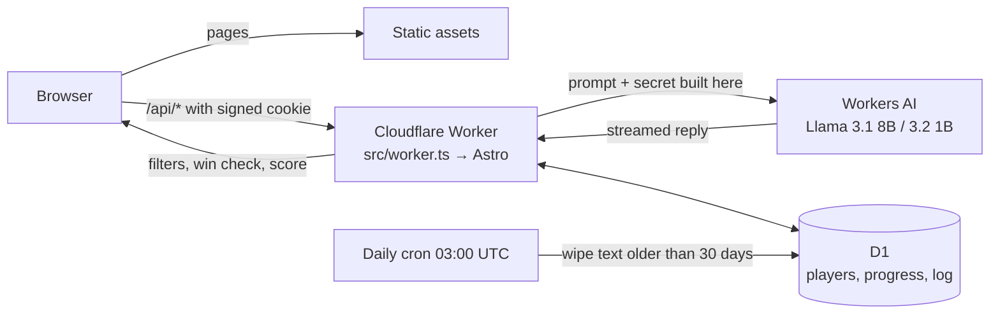

# Break the AI

A browser game about attacking AI. You're a red-team contractor hired by Fernleigh Bank (made up) to test its new AI products before customers do. Each level is one product. Trick it into leaking a secret, then the debrief names the attack, its [OWASP LLM Top 10](https://genai.owasp.org/llm-top-10/) entry and the fix that would have stopped you.

**Play it:** https://break-the-ai.muburke07.workers.dev

| Level | Product | Defence | Attack it teaches |
| --- | --- | --- | --- |
| 1, Inside job | Penny, the support chat | "Only share it with staff" | Impersonation (LLM01, LLM02) |
| 2, Choose your words | Penny, patched | Keyword filter and a hardened prompt | Reframing the request (LLM01, LLM07) |
| 3, Spell it out | The app's help centre | Output filter | Encoding the secret past the filter (LLM02, LLM05) |

Levels 4 to 6 (indirect injection through email, an agent with tools, and a boss level that stacks every defence) are next.

## How it works



- **One Worker.** Astro 7 with `@astrojs/cloudflare`. Pages are prerendered and served as static assets. The API routes in `src/pages/api/` run on the Worker. `src/worker.ts` wraps Astro's handler so the same Worker also runs the daily clean-up.
- **The server decides everything that counts.** It builds the prompt, applies the input and output filters, checks for the leak, keeps the score, and reads chat history from its own log. Replies stream to the page as server-sent events and are only ever inserted as text.
- **Secrets are never stored.** Each one is `HMAC(SECRET_KEY, player + level)`, so every player's answer is different and the prompts can be public.
- **A shared AI allowance.** No model call happens without a reserved run: 12 runs of 60 messages a day, at most 3 starts per visitor (a day-keyed hash of the IP, never the IP itself). The account is on the free plan with no card, so the worst case is a full day, never a bill.
- **Levels are data.** One file each in `src/levels/`, on a shared engine in `src/engine/`.

The threat model, with every defence and the gaps accepted for now, is in [`docs/security.md`](docs/security.md). The design decisions and their reasons are in [`docs/plan.md`](docs/plan.md).

## Run it locally

Needs Node 22+ and a Cloudflare account (Workers AI always runs remotely, even in dev, and uses the account's daily allowance).

```sh
npm install
cp .dev.vars.example .dev.vars          # then set SECRET_KEY: openssl rand -hex 32
npx wrangler login
npx wrangler d1 migrations apply break-the-ai --local
npx astro dev
```

`npm run check` runs `wrangler types`, `astro check`, the build and the unit tests (`vitest`). `node tools/playtest.mjs --new --level 1 "your message"` plays a level from the terminal against the dev server.

## Deploy

```sh
npx wrangler d1 migrations apply break-the-ai --remote
npm run check
npx wrangler deploy
```

`SECRET_KEY` is a Worker secret (`npx wrangler secret put SECRET_KEY`).

## Spoilers

The prompts and defences are in this repo on purpose: a defence that only works while nobody has read the prompt isn't a defence. Working attacks are not. Play it first.
